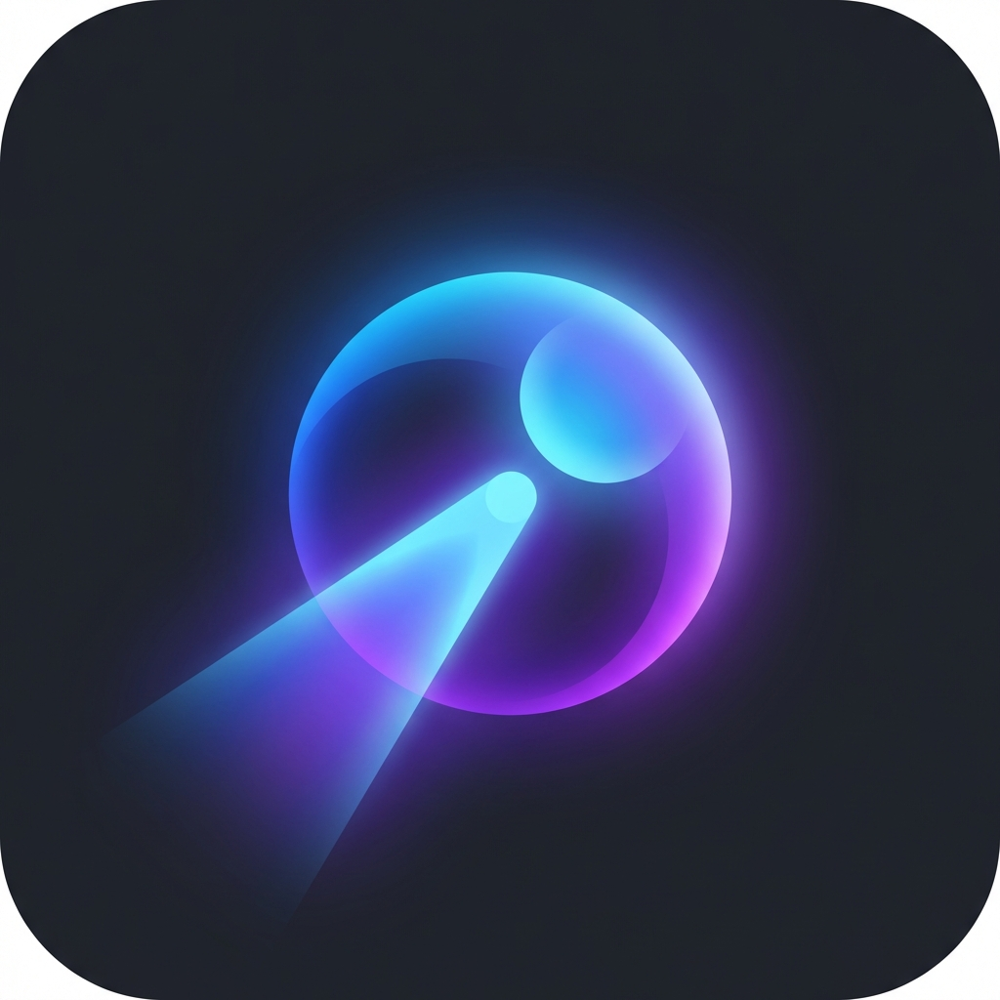

# Lumina

**Lumina** is a Chrome Extension that leverages the power of multiple GenAI models (Gemini, ChatGPT, and Claude) to explain *anything* currently visible on your screen. Whether it's a presentation slide, a complex research paper, a news article, or a data dashboard, **Lumina** provides instant, multi-perspective insights.

## Features

-   **Universal Capture**: Works on potentially any website (including restricted ones like LinkedIn) thanks to enhanced permissions.
-   **Always-On Intelligence**: Automatically re-analyzes the page when you **switch tabs** or **navigate** to a new URL.
-   **Multi-Model Intelligence**: Get explanations from four leading AI models:
    -   **Google Gemini 1.5 Flash**
    -   **OpenAI GPT-4o**
    -   **Anthropic Claude 3.5 Sonnet**
    -   **DeepSeek R1 (Reasoner)** 🦈
-   **Super Prompt Bar**: A unified, pill-shaped input bar for all your interactions.
    -   **Voice Input (🎤)**: Speak your query directly using the Web Speech API.
    -   **Page Text Loading (📥)**: Instantly grab text from the page to use in your prompt.
    -   **Smart Toggles**: Easily toggle Screenshot (📸) and Page Text (📄) context on/off.
-   **Chain of Thought Display**: See the reasoning process behind DeepSeek's answers in a dedicated collapsible section.
-   **Focused Configuration**: Click the ⚙️ icon next to any model to quickly configure just that specific provider.
-   **Side-by-Side Comparison**: Compare how different AIs interpret the same content in a single view.
-   **Secure**: Your API keys are stored locally in your browser (`chrome.storage.local`) and never sent to our servers.

## Installation

Since this is a developer preview (unpacked extension):

1.  **Clone/Download** this repository.
2.  Open Chrome and navigate to `chrome://extensions`.
3.  Enable **Developer mode** (top right toggle).
4.  Click **Load unpacked** (top left).
5.  Select the folder containing this project (where `manifest.json` is located).

## Configuration

Lumina makes setup easy with direct links to get your keys:

1.  Click the **Lumina** extension icon (ensure it's pinned for easy access).
2.  Open the Side Panel.
3.  Click the **Gear Icon (⚙️)** next to any model (e.g., DeepSeek).
4.  Click the **"Get Key"** link to open the provider's API page:
    -   [Google AI Studio](https://aistudio.google.com/app/apikey)
    -   [OpenAI Platform](https://platform.openai.com/api-keys)
    -   [Anthropic Console](https://console.anthropic.com/settings/keys)
    -   [DeepSeek API](https://platform.deepseek.com/api_keys)
5.  Paste your key and click **Save**.

## Usage

1.  Navigate to any webpage, slide, or document you want to understand.
2.  Click the **Lumina** extension icon.
3.  **Super Prompt Bar**: Type or Speak your question. Toggle screenshot/text context as needed.
4.  **DeepSeek CoT**: Expand the "DeepSeek Thought Process" to see how the model arrived at its answer.
5.  **Multi-Model Results**: View explanations from all configured models simultaneously.

## Technologies Used

-   **Manifest V3**: Modern Chrome Extension architecture.
-   **Vanilla JS/HTML/CSS**: Lightweight and fast, no heavy build steps required.
-   **REST APIs**: Direct integration with AI providers.

## Owner & Copyright

**Created by Harsh Raj Singh.**
All Rights Reserved.

## License

**Proprietary Software.**
This project is owned by Harsh Raj Singh. Unauthorized copying, modification, distribution, or use of this software is strictly prohibited.
